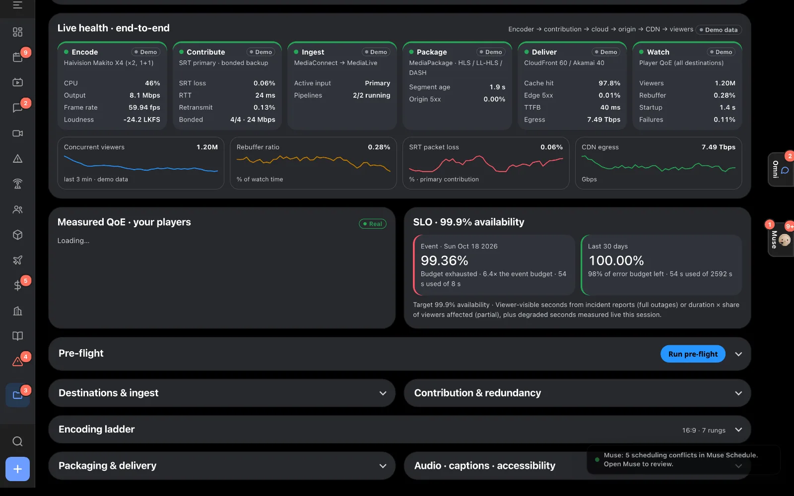
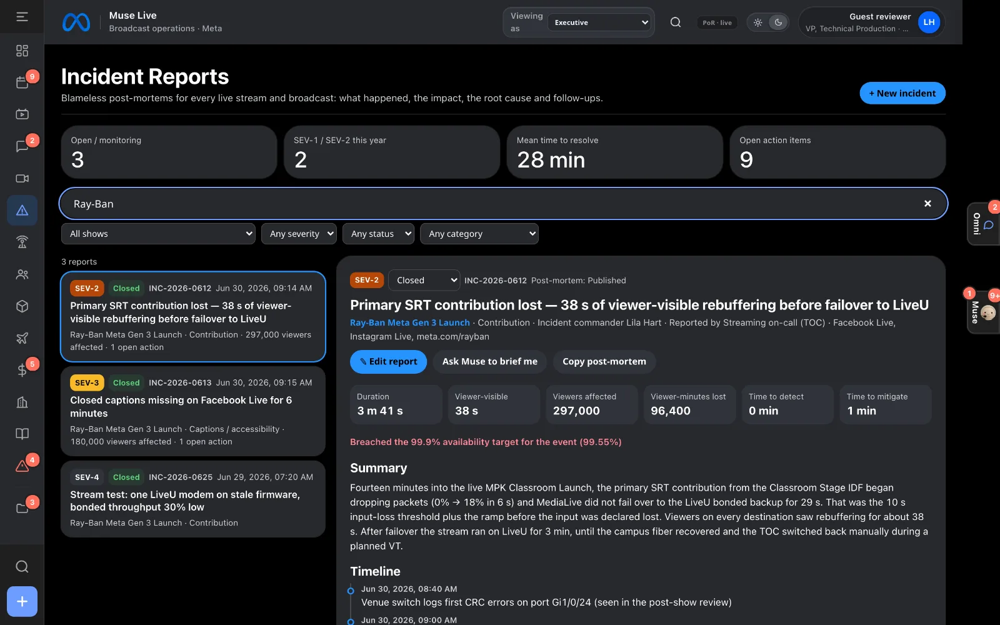
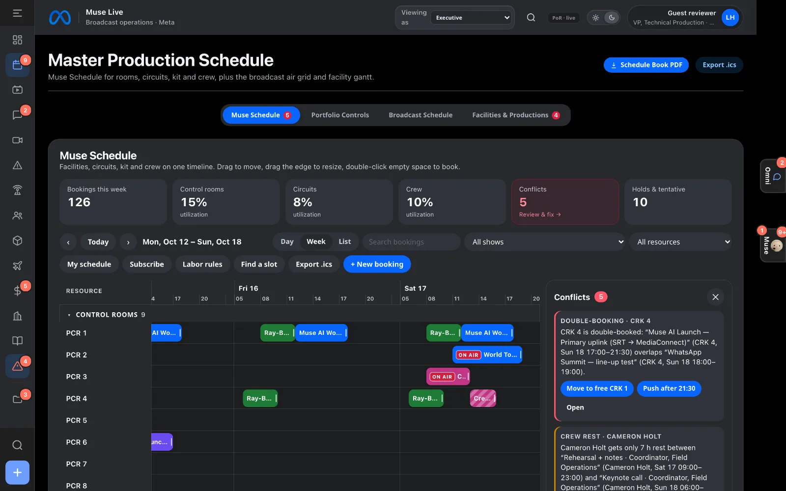
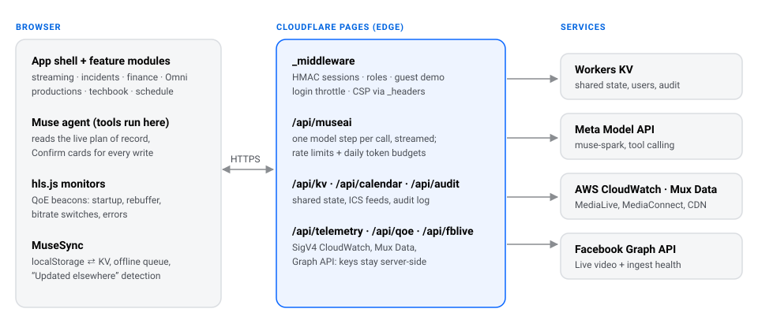

<p align="center">
  
</p>

<p align="center">
  
</p>

<h1 align="center">Muse Live</h1>

<p align="center">
  <b>Live broadcast and streaming operations.</b><br>
  Plan every show, watch every stream end to end, learn from every incident.
</p>

<p align="center">
  <a href="https://muse-live.pages.dev"></a>
  <a href="https://muse-live.pages.dev/about"></a>
</p>

<p align="center">
  
  
  
  
  
</p>

---

Muse Live is an operations platform for live events that are both broadcast and streamed: the plan of record for every show, end-to-end stream health from encoder to viewer, blameless incident reports, finance, per-show communication, and **Muse**, an AI agent that can read all of it and propose changes for a person to confirm.

> **Try it:** open the [live demo](https://muse-live.pages.dev) and press **Start the 90-second demo**. No sign-in needed: you get a read-only guest session and a guided tour that plays itself (Space pauses, arrows step, Esc ends).

## Who built it

**Carlos Hurtado.** Designed and built Muse Live: product, front end, edge functions, the Muse agent, tests and the guided demo. [GitHub](https://github.com/carloshurtado-tech)

## Built during the Meta Global AI Developer Hackathon (Oct 27 – Nov 4, 2026)

Muse Live itself predates the event (engineering retrospective: [docs](docs/ARCHITECTURE.md)). The hackathon theme is **Build for Your World** — the world here is live broadcast operations. Commit dates: 32 commits predate Oct 27, 2026 (including the Oct 15 Muse Live rebrand); every commit whose message says “Day” is dated Oct 27, 2026 — “Day 1–7” names work packages, not separate calendar days. See the dated disclosure on the [About page](https://muse-live.pages.dev/about#hackathon).

| Feature | What it does today | Code | Verified by |
|---|---|---|---|
| **Show Caller** | Deterministic, rules-based risk brief: reads schedule, streams, incidents, crew, equipment and ops records into a ranked brief with the source record behind every line, then proposes fixes a human approves. Approval re-verifies the world before executing and stale plans refuse themselves; nothing moves an on-air booking. The approval reachable in the UI today is the test-feed retry; Show Caller does not call `/api/museai` and no Slack/Gmail send fires from Approve until targets and production secrets are wired (see Runbook). | [js/muse-showcaller.js](js/muse-showcaller.js) | Scenario eval in [tests/unit/showcaller.test.mjs](tests/unit/showcaller.test.mjs) (`npm test`) |
| **Stream Check** | SAM 3.1 segments the program frame via `/api/streamcheck` (the model endpoint receives the frame; no chat model sees pixels). Black frames are caught by pixel math; lower-third presence is checked against the `caption bar` concept. Errored checks are reported as **unavailable**, never as clean. No gear-vs-checkout comparison is wired at the call sites today, so none is claimed. Flags flow into Show Caller's brief. | [functions/api/streamcheck.js](functions/api/streamcheck.js), [js/muse-streamcheck.js](js/muse-streamcheck.js) | Offline fault matrix + unit tests (`npm test`) |
| **Omni connectors** | Slack posting (bot token + webhook fallback) and Gmail sending (least-privilege `gmail.send`) inside the existing per-show thread, with stored IDs and audit on both outcomes. Requires `SLACK_*` / `GMAIL_*` secrets in production; without them sends fail closed. | [functions/api/omni/](functions/api/omni/) | Unit tests (`npm test`); live sends need production secrets (owner) |
| **Live captioning** | Chunked captions over Voice Transcribe with a searchable stored transcript — the post-show transcript exists by construction. | [functions/api/transcribe.js](functions/api/transcribe.js), [js/muse-captions.js](js/muse-captions.js) | Unit tests (`npm test`) |

Meta models used through the Meta Model API: **Muse Spark 1.3** (Muse drawer reasoning + tool calls via `/api/museai`), **SAM 3.1** (segmentation), **Muse Voice Transcribe 1.0** (speech). No image-generation model is called by this codebase (`grep -r muse-image js functions` → 0 hits); seeded Site Survey photos that are AI-generated are labelled illustrative in the app and are never presented as real frames. Built with **Muse Code**. Gateway, auth, streaming/scheduling/incident modules and the 90-second tour predate the window and are unchanged except where the new features plug in.

## What you’ll see


<sub>**Streaming:** end-to-end health per show: encoder → SRT contribution → MediaConnect/MediaLive → packaging → multi-CDN → player QoE. Each show also tracks a 99.9% availability SLO with its error budget.</sub>

<table>
  <tr>
    <td width="50%"></td>
    <td width="50%"></td>
  </tr>
  <tr>
    <td><sub><b>Incidents:</b> blameless post-mortems with impact, time to detect and mitigate, root cause, timeline and owned follow-ups.</sub></td>
    <td><sub><b>Scheduling:</b> rooms, circuits, encoders, trucks and crew on one timeline, with conflicts and labor rules checked as you book.</sub></td>
  </tr>
</table>

**The guided demo** walks through: the home view → the Live Streams wall → one show’s end-to-end streaming chain → incident post-mortems → finance (“always on budget”) → Muse answering live → Omni, every conversation for a show in one place → the techbook, built as a PDF from live data and opened in a new tab.

## The job, and where it lives in the app

| Streaming & broadcast responsibility | In Muse Live |
| --- | --- |
| **Deliver live events end to end** | Per-show streaming plan: destinations and ingest, contribution and redundancy (SRT primary, bonded cellular backup), packaging (HLS / LL-HLS / DASH), CDN, captions and loudness, pre-flight and go-live checklist. |
| **Encoding and ABR ladders** | Encoding ladder per show: rungs, codecs and bitrates on the plan of record. |
| **Monitoring and quality of experience** | Live Streams wall; per-hop health; hls.js QoE beacons (startup, rebuffer, bitrate switches, errors); AWS MediaLive / MediaConnect / CloudFront and Mux Data adapters; availability SLO with error budget. |
| **Incident response and post-mortems** | Incident Reports: severity, viewer impact, time to detect and mitigate, timeline, root cause and action items, linked to each show. |
| **Event production and broadcast planning** | Department readiness, techbook PDF export, site surveys, venue drawings, power and fiber, gear and crew, for a world tour across Meta offices. |
| **Resources: encoders, circuits, rooms, crew** | Muse Schedule with conflict detection, labor rules, crew self-service and ICS calendar feeds. |
| **Budget and vendors** | Finance: budget against actuals, purchase orders, invoices and vendor payments per show. |
| **Communication** | Omni: every email, Teams chat and TOC alert linked to the show, PO or incident it is about. |
| **Facebook and Instagram Live** | Server-side Graph API proxy for live video status and ingest stream health. |
| **Automation and tooling** | Muse, an agent with tools over all of the above; every write goes through a human confirmation step. |

## Architecture

<p align="center"></p>

A static single-page app at the edge, a thin server layer for anything secret, and an agent loop where the model plans and the browser runs the tools.

### How Muse answers a question

The model never sees the database and never writes on its own.

1. The browser builds a live snapshot: every show’s readiness, dates, stream health and open incidents.
2. `POST /api/museai` adds the persona and tool schemas and makes **one** call to Meta Model API, so the key never leaves the server.
3. If the model asks for tools (production, techbook, crew, schedule, streaming, incidents, weather…), the browser runs them against the plan of record and posts the results back, for up to 8 steps.
4. Anything that would change data comes back as a **Confirm** card. A person decides, and Undo is offered.

## How it’s checked

| Result | What it measures |
| --- | --- |
| **40 / 40** | Muse accuracy eval on the real model, median answer 5.8 s ([eval/REPORT.md](eval/REPORT.md)) |
| **`npm test`** | unit tests (Node 22): auth, sessions, guest access and AI spend limits, KV + conditional writes, sync, incidents, SigV4, telemetry schema, abuse guards, build — count reported by the runner at run time |
| **Playwright** | end-to-end tests, including a crawl of every view and every show tab — count reported by the runner at run time |
| **axe** | WCAG 2.1 AA checks on the landing page, About page and main views, light and dark ([tests/e2e/a11y.spec.mjs](tests/e2e/a11y.spec.mjs)) |

## Decisions and trade-offs

- **Edge first, no servers to run.** Static assets and Functions on Cloudflare Pages, state in Workers KV: deploys in seconds, nothing to patch, close to viewers everywhere.
- **Tools run in the browser.** The plan of record lives client-side today, so the agent’s tools do too; the server relays one model step at a time. As data moves into KV, tools can move server-side unchanged.
- **Simulated where it must be, real where it can be.** Pipeline numbers are a seeded simulation labeled *Demo* until a stream is connected to CloudWatch, Mux or Facebook Live; video monitors, QoE beacons and pre-flight checks are real.
- **Read-only by role, enforced on the server.** Viewer sessions, including the public guest demo, are refused by every write endpoint. Guests get their own Muse rate limit, request-size and output caps, and a daily token budget charged before each call.
- **Blameless by design.** Incident reports focus on the system and the timeline, and every follow-up has an owner and a status.
- **Accessible from the start.** Keyboard paths, focus management, screen-reader announcements (including the guided tour) and contrast checked in both themes.

## Honest limits

- Viewer counts, bitrates and other pipeline metrics are simulated unless a show is connected to real telemetry; every simulated number is labeled *Demo*.
- Stream monitors play public recordings of Meta events from YouTube, standing in for live program feeds.
- Most views are string-template JavaScript from an earlier build; newer modules are self-contained, and [docs/MIGRATION.md](docs/MIGRATION.md) plans the move to React + TypeScript.
- Shared storage is last-write-wins per key unless clients send `If-Match` / `If-None-Match`
  (optimistic concurrency, 412 on conflict): fine for a small team, not for a large one.
- This is a concept demo, not an official Meta product.

---

## Run it locally

```bash
npm ci                         # dev tooling only — the app itself has no runtime dependencies
cp .dev.vars.example .dev.vars # or create it: MODEL_API_KEY=…  MUSE_PASSWORD_HASH=…
npm run dev                    # http://127.0.0.1:8788
```

`MUSE_PASSWORD_HASH` is `sha256("muse-live:" + <password>)`:
`printf 'muse-live:%s' 'your-password' | shasum -a 256`.
Without `MODEL_API_KEY`, Muse answers from built-in rules (offline mode).

`tools/dev-server.mjs` is a small Cloudflare Pages emulator in plain Node: it runs the middleware
and `functions/api/**`, applies `_headers`, and emulates the `MUSE_KV` binding (persisted to
`.dev-kv.json`). It exists because `wrangler pages dev` (workerd) needs macOS 13.5+. It binds
127.0.0.1; `--host` overrides this with an explicit warning — the dev server is unhardened, so
never expose it to the public internet (see [Security](docs/SECURITY.md)).

| Command | What it does |
| --- | --- |
| `npm run dev` | Local server with Functions + KV emulation |
| `npm run build` | Minify `js/muse-app-a.js` / `-b.js` → `*.min.js` + source maps, bump the `?v=` cache tag |
| `npm test` | Unit tests (`node:test`) |
| `npm run test:e2e` | Playwright end-to-end tests against the dev server and a mock Meta Model API |
| `npm run lint` / `npm run typecheck` | ESLint + TypeScript (JSDoc) checks for platform code and Functions |
| `npm run stage` | Deployable copy in `.stage/` (no tests, docs, sources, maps or secrets) |

**Docs:** [Architecture](docs/ARCHITECTURE.md) · [Security](docs/SECURITY.md) · [Runbook](docs/RUNBOOK.md) · [Migration plan](docs/MIGRATION.md) · [Privacy](https://muse-live.pages.dev/about#privacy) · [Third-party notices](THIRD_PARTY_NOTICES.md) · Admin pages at `/ops/` (health, audit log, users).

<p align="center"><sub>Muse Live is a concept demo by Carlos Hurtado and is not affiliated with or endorsed by Meta. Meta, Ray-Ban, Instagram, WhatsApp and Muse are trademarks of their owners. Event recordings belong to their owners.</sub></p>
