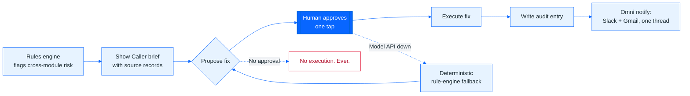
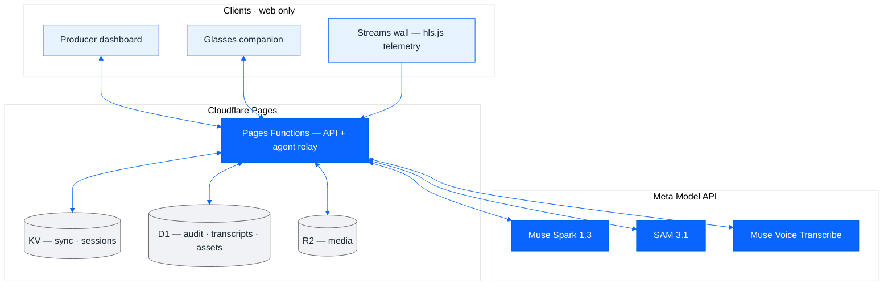

<p align="center">
  
</p>

<h1 align="center">Muse Live</h1>

<p align="center">
  <em>The agent proposes. A human decides.</em>
</p>

<p align="center">
  <b>An operations safety net for live broadcast.</b><br>
  Plan every show, watch every stream end to end, learn from every incident.
</p>

<p align="center">
  <a href="https://muse-live.pages.dev"></a>
  <a href="https://muse-live.pages.dev/about"></a>
  <a href="#hackathon-build-new-work-since-oct-26-2026"></a>
</p>

<p align="center">
  
  
  
  
  
  
</p>

<p align="center">
  
</p>

<p align="center">
  <strong>292 / 292 unit &middot; 20 / 20 browser &middot; 40 / 40 model eval &middot; 0 axe violations.</strong><br>
  <sub>Measured Nov 1, 2026 on Node 22 + Playwright Chromium/Firefox. Every number in this README comes from a run log.</sub>
</p>

## Hackathon build: new work since Oct 26, 2026

Built for the **Meta Global AI Developer Hackathon** (Oct 27 – Nov 4, 2026), Indie track, theme **Build for Your World** — the world here is live broadcast operations.

> **Judges start here.** Everything below was built in the hackathon window: commits dated **Oct 27, Oct 31, Nov 1, or Nov 2, 2026** — nothing backdated. Verify it yourself: `git log --since=2026-10-26` reproduces the full in-window history (63 commits at time of writing). Nothing else in this demo is claimed as new.

### How it was built

Built with **Muse Code** (the agentic coding CLI, powered by **Muse Spark**): the agent wrote the code, ran the checks, and iterated against failing tests — the same Detect → Propose → Approve → Execute → Notify loop the product itself implements. Models via the **Meta Model API** (table below); hosting on **Cloudflare Pages + Functions** with Workers KV, D1, and R2; every number verified by the repo's own suites (`npm run check`, Playwright, `eval/REPORT.md`).

Built on a 2015 13-inch MacBook Pro (2.9 GHz dual-core i5, 8 GB RAM, Intel Iris 6100, macOS Monterey 12.7.6) — the whole hackathon build ran on this machine.

### Feature map (all commits dated Oct 27 – Nov 2, 2026)

| # | What judges open | Key files | Dated commits | Built with / verified by |
|---|---|---|---|---|
| 1 | Show Caller risk brief + fix proposals (open a show) | `js/muse-showcaller.js` | `e5beea1` (Days 1–2) | Deterministic rules engine; 14-scenario eval in `tests/unit/showcaller.test.mjs` |
| 2 | Approval + execution + glasses tally republish ("Approve & run" on a test-feed retry) | `js/muse-showcaller.js`, `functions/api/omni/` | `bd1b44e` (Day 3), `ff34f64` (Day 7 freeze) | Approval re-verifies the world first; stale plans refuse themselves; e2e-covered |
| 3 | Stream Check frame analysis (Streams wall → tile → theater, `caption bar` check) | `js/muse-streamcheck.js`, `functions/api/streamcheck.js` | `c40872e` (Days 4–5), `04a3ade` | **SAM 3.1** segmentation; black frames by pixel math; errors report **unavailable**, never clean; offline fault matrix (Black 30/30, down 30/30, frozen 24/30, muted 27/30) |
| 4 | Chunked live captions + searchable transcript + SRT/VTT export | `js/muse-captions.js`, `functions/api/transcribe.js` | `c40872e`, `35bc358`, `953a6d1` | **Muse Voice Transcribe 1.0**, manual start only, stated ~12 s lag |
| 5 | Muse drawer answers + SAM alerts + proactive briefs | `js/muse-agent.js`, `js/muse-proactive.js`, `functions/api/museai.js` | `35bc358`, `650e6b6` | **Muse Spark 1.3** reasoning + tool calls; every write a Confirm card; 40/40 model eval ([eval/REPORT.md](eval/REPORT.md)) |
| 6 | Omni Gmail/Slack per-show threads | `functions/api/omni/`, Omni view | `bd1b44e`, `1cfe9b3`, `3a56898` | Sends file in the show's thread when secrets exist; fail closed (`503 configured:false`) otherwise — never simulated |
| 7 | i18n: Functions strings + access gate in en/es/pt | `functions/_middleware.js`, `functions/_lib/` | `034f158`, `ea8ca8e` | Externalized via `Accept-Language` |
| 8 | D1 + R2 data layer: queryable transcripts (FTS), media blobs, audit log, D1 schema | `migrations/`, `functions/_lib/` | `27e4feb`, `f8a3e3c` | Queryable by construction; audit entry written on every approval |
| 9 | 2.0 ops pack: tasks + automations, asset register/CRM + graph + search, templates + picker, site survey + findings log, Site Gallery, CAD plan attachments, 360° pano walkthrough + hold-to-place, Astryx tokens, perf foundations | `js/muse-tasks.js`, `js/muse-assets.js`, `js/muse-survey*.js`, `js/muse-templates.js`, `css/astryx-tokens.css` | `fcf158b`, `f8a3e3c`, `8eec207`, `46dd00c` | Asset history deterministic order; unit-tested |
| 10 | Streams wall + theater: HLS-only transport, live telemetry of each stream, manual captions, external feeds, freeze + stateful controls, 4-feed cap, test-feeds-only wall | `js/muse-streaming.js`, `js/muse-testfeeds.js` | `4aff047`, `2e138e1`, `eefd638`, `1cfe9b3`, `953a6d1`, `40b77c2`, `1193c9a` | Real HLS feeds with telemetry; idle HLS suspends; dead-embed fallback; viewport fit |
| 11 | Dashboard density pass + 90%-zoom demo frames + rail badges | `index.html`, `js/muse-app-a/b.js` | `eefd638`, `08fb817`, `650e6b6` | Tighter density; proactive-crash fix; CWV fixes (`c40872e`) |
| 12 | Sun & Shadow panels, Shadow Map, QC, telemetry fixes, rehearsal + signals, Techbook rebuilt with Show Bible appendix (risk register, stream health, run of show, comms plan) | panels + `js/muse-*.js`, `js/muse-export-gear.js` | `31aa2de`, `1cfe9b3`, `35bc358` | API-key wiring + pitch cap; Chromium drag fix; Techbook exports live data |
| 13 | Meta Ray-Ban Display companion content, login Meta marks, guided-tour removal, README/About rebuild | `glasses/`, `glasses-src/`, `about.html`, `README.md` | `6ee0f3f`, `41591af`, `79f9d17`, `7f44da6` | Same sign-in; stale status (>60 s) says "Demo data" aloud |
| 14 | Security hardening + final DEBUG pass (BUG-01..46), dark-mode fixes | whole app, `functions/_middleware.js` | `04a3ade`, `cc14043` | 292 unit, 20/20 browser e2e, 0 axe violations; HMAC sessions, read-only viewer enforcement, model-down rule fallback |
| 15 | Open-source release + license + deploy rotation | `LICENSE`, `THIRD_PARTY_NOTICES.md`, `submission-draft.md` | `95f1c21` (GPL-3.0), `9897323`, `6f2d6b7`, `11b31b0` | Repo public; logged-out guest path verified 200 |
| 16 | UI follow-through: Omni drawer posts to real Slack (per-show channel, sent/failed status), badge counts reconciled across Slack surfaces, Muse-noticed newest-first + conflict deep-link, sidebar Glasses entry, one favicon everywhere, finance bubble → AP tab → invoice document, README/About hackathon surfacing | `js/muse-app-b.js`, `js/muse-app-a.js`, `js/muse-showcaller.js`, `js/muse-schedule.js`, `js/muse-proactive.js`, `functions/api/omni/`, `index.html`, `about.html`, `README.md`, `tests/unit/` | `c1b7a89`, `0ac185d`, `2ff5abe`, `4fb1b98`, `1bdcd86`, `8d8728b` | Real POSTs with honest errors; regression tests added; 303 unit green; deployed + verified live |
| 17 | One-button judge entry (read+write, no sign-in) + resolved notices auto-clear + finance per-tab counts + About map parity | `index.html`, `functions/_middleware.js`, `js/muse-app-b.js`, `about.html` | `ea327df`, `85be1a4`, `3a6aa44`, `e0a6429` | Producer guest sessions; AP overdue red / AR open blue; About mirrors this map |
| 18 | Every error, notice and conflict opens Muse with a fix request; streams wall lists live programs as rows | `js/muse-app-a/b.js`, `js/muse-streaming.js`, `js/muse-proactive.js`, `tests/unit/muse-ask.test.mjs` | `dc0d18c`, `564e226` | Fix-request convention pinned by tests; rows mount no decoders |
| 19 | Omni↔Slack two-way mirror: project channel + topic-as-thread, inbound sync on open + manual Sync | `functions/api/omni/slack.js`, `functions/api/omni/slack-thread.js`, `js/muse-app-b.js`, `js/muse-showcaller.js` | `f7cf70c` | Bot-token threading; honest errors when unconfigured |
| 20 | Wall count locked to one helper + Reset states; stream alerts clickable into Muse with live values | `js/muse-streaming.js`, `css/muse.css` | `df6cd26`, `79dc6ac` | KPI, rows and dashboard stat can't disagree; JSON surfaces unchanged |
| 21 | Popups shift clear of the open drawer; Glasses under Dashboard; glasses Talk-to-Muse voice+text; monitors open the theater at one size with Ask Muse | `css/muse.css`, `js/muse-app-a.js`, `js/muse-streaming.js`, `glasses/` | `faf75ea`, `e3b16a5` | Drawer transform untouched; theater prompt carries telemetry + open issues |
| 22 | Notices open their solution + delete from the panel; dashboard grid rebalanced; glasses `?incident=` demo flow (Ask Muse → Approve failover → All clear) | `js/muse-proactive.js`, `js/muse-app-a.js`, `glasses-src/`, `glasses/`, `tests/unit/snapshot.test.mjs` | `f4c89ea`, `da733e4` | Tag-balance regression test; 331 unit green; fresh glasses bundles deployed |

History mechanics, not features: `41786a6` reverts `main` to `034f158` (undoing the `f5c7ff2` merge); `ff34f64` then re-applies the Day 2–7 work. `6190c09`/`6f2d6b7` record the private→public decision trail. `d17cba9`/`86b7c1e` are local tweaks and rebuild triggers. `98a6f80`/`e44223c`/`c33687a` were a superseded demo-overlay experiment, fully reverted by `734545d` — none of that code is in the tree.

**Not claimed:** the Oct 15–19 base (rebrand from the NBC "Pulse" tool in `fde343c`, login shell, nav rail, seeded demo content) and any view untouched by the commits above.

---

## The problem

Live broadcast runs on scar-tissue judgment. The failure modes are cross-module: an encoder dies *while* a camera operator is double-booked *while* the backup path is promised to another show — and no single human watches schedule, streams, crew, equipment, and comms at once. Muse Live is the one place that does, with an agent that proposes the fix and a human who decides.

**Carlos Hurtado** designed and built Muse Live: product, front end, edge functions, the Muse agent, tests, and deployment. [GitHub](https://github.com/carloshurtado-tech)

| Without Muse | With Muse |
|---|---|
| Camera op double-booked on two positions. Nobody sees it until air. | Show Caller flags the conflict, citing both schedule records. |
| Frantic reassignment over IFB during the show. | The proposed fix with its sources on screen, approved with one tap. |
| The fix happens — or it doesn't — with no record. | Audit entry written; the crew notified in one Omni thread. |

## What Muse does (the loop)

1. **Detect** — Show Caller builds a deterministic, rules-based risk brief across schedule, streams, incidents, crew, and equipment. Every line carries the source record it came from; nothing is invented.
2. **Propose** — each risk comes with a concrete fix. The Muse drawer (Muse Spark) can also answer questions and draft changes against the same live snapshot.
3. **Approve** — a human approves with one tap. Approval re-verifies the world first; stale plans refuse themselves. Nothing moves an on-air booking.
4. **Execute** — the approved fix runs and an audit entry is written. The approval reachable in the UI today is the human-approved test-feed retry.
5. **Notify** — Omni files Slack and Gmail in the same per-show thread when production secrets are configured; without them, sends fail closed (`503 configured:false`), never simulated.

If the Meta Model API is unreachable, the deterministic rule engine keeps the safety net up — degraded, never silent.



## How Meta AI was used

| Model (Meta Model API) | Job in this project | Where |
|---|---|---|
| **Muse Spark 1.3** (`muse-spark-1.3`) | Muse drawer: reasoning + tool calls over the live production snapshot; every write returns as a Confirm card | `POST /api/museai` → [js/muse-agent.js](js/muse-agent.js) |
| **SAM 3.1** | Stream Check frame segmentation (lower-third `caption bar` concept); black frames caught by pixel math; errored checks report **unavailable**, never clean | [functions/api/streamcheck.js](functions/api/streamcheck.js), [js/muse-streamcheck.js](js/muse-streamcheck.js) |
| **Muse Voice Transcribe 1.0** (`muse-voice-transcribe-1.0`) | Chunked live captions (manual start only — playback never auto-starts billing) + searchable stored transcript with SRT/VTT export | [functions/api/transcribe.js](functions/api/transcribe.js), [js/muse-captions.js](js/muse-captions.js) |

Deliberately **not** used: no image-generation model is called anywhere (`grep -r muse-image js functions` → 0 hits; AI-generated survey photos are labelled illustrative in-app), no non-Meta LLM in the product path, and no silent model substitute — the fallback is deterministic rules.

## Architecture

Static app on Cloudflare Pages + Pages Functions, state in KV / D1 / R2, custom HMAC sessions (OIDC/PKCE + PBKDF2 where configured), prompt-injection fencing and per-session token budgets on the agent path. Web only: the control room, the truck, and the glasses companion reach the same backend.



## Proof (measured, Nov 1, 2026)

| Check | Result |
|---|---|
| `npm run check` (ESLint + `tsc` + unit, Node 22) | **292 / 292 pass** |
| Playwright e2e, Chromium (gate, crawl of every view + every show tab, streams, shade, sync, a11y) | **20 / 20 pass** |
| Playwright a11y + Sun & Shadow, Firefox | **3 / 3 pass** (axe WCAG 2.1 AA, light + dark: 0 violations) |
| Muse accuracy eval on the real model | **40 / 40**, median answer 5.8 s ([eval/REPORT.md](eval/REPORT.md)) |
| Stream Check offline fault matrix | Black 30/30, down 30/30, frozen 24/30, muted 27/30; 0 false alarms on 90 clean samples |

Every number above comes from a run log. Anything unmeasured is stated as a limit below, never estimated.

## What you'll see

<sub>**Streaming** (hero shot above): end-to-end health per show: encoder → SRT contribution → ingest → packaging → multi-CDN → player QoE, with a 99.9% availability SLO and error budget.</sub>

<table>
  <tr>
    <td width="50%"></td>
    <td width="50%"></td>
  </tr>
  <tr>
    <td><sub><b>Incidents:</b> blameless post-mortems with impact, time to detect and mitigate, root cause, timeline and owned follow-ups.</sub></td>
    <td><sub><b>Scheduling:</b> rooms, circuits, encoders, trucks and crew on one timeline, with conflicts and labor rules checked as you book.</sub></td>
  </tr>
</table>

Also in the app: per-show streaming plans and ABR ladders, hls.js QoE beacons, Muse Schedule with ICS calendar feeds, Finance (budget vs actuals), Omni (every conversation linked to its show), site surveys, and techbook PDF export from live data.

## On your face: the Meta Ray-Ban Display companion

The producer's view, on Meta glasses. The desktop publishes a live status every 10 seconds — every show's state and health, open incidents, and what's next on air (or "unknown", never invented) — and the [glasses app](glasses/) renders tally, alerts, and the show status a floor producer actually needs, built on `@wearables-ui-toolkit/mrbd` with the same sign-in as the main app. Publishing continues on a background cadence, so switching tabs never quietly turns the glasses into a demo; if the status goes stale for over 60 seconds, the glasses say "Demo data" out loud instead of presenting old numbers as live.

## Explore on your own

No sign-in needed for the guest path:

1. Open [muse-live.pages.dev](https://muse-live.pages.dev) and choose **Explore on your own** — you get a read-only guest session (every write endpoint refuses viewers).
2. Open the **Live Streams** wall and click any tile to enter the theater (transport, live measurements, captions repository).
3. Open a show and ask **Muse** a question; watch it read the plan of record and answer with its working shown.
4. Open [/glasses/](https://muse-live.pages.dev/glasses/) to see the same live status on the Meta Ray-Ban Display companion.

Team sign-in uses the access password (held by the owner; never published here).

## Repo map

| Path | What lives there |
|---|---|
| `js/muse-showcaller.js`, `js/muse-streamcheck.js`, `js/muse-streaming.js` | Risk brief, Stream Check, streams wall + theater |
| `js/muse-agent.js`, `functions/api/museai.js` | Muse drawer + model relay (keys stay server-side) |
| `functions/api/omni/`, `functions/api/transcribe.js`, `functions/api/voice.js` | Slack/Gmail connectors, captions, push-to-talk |
| `functions/_middleware.js`, `functions/_lib/` | Access gate, sessions, audit, abuse guards |
| `glasses/`, `glasses-src/` | Ray-Ban Display companion (built output + source) |
| `tests/unit/`, `tests/e2e/`, `eval/` | Unit + browser tests, model eval harness |
| `docs/` | [Architecture](docs/ARCHITECTURE.md) · [Security](docs/SECURITY.md) · [Runbook](docs/RUNBOOK.md) · [Migration](docs/MIGRATION.md) |

## Hackathon disclosure (before / during)

Built for the **Meta Global AI Developer Hackathon** (Oct 27 – Nov 4, 2026), Indie track, theme **Build for Your World** — the world here is live broadcast operations. The full new-work map is the [section above](#hackathon-build-new-work-since-oct-26-2026).

Muse Live itself predates the window: 32 commits are dated Oct 15–19, 2026, including the Oct 15 rebrand from an NBC "Pulse" operations tool (`fde343c`). Every commit whose message says "Day" is dated Oct 27, 2026 — "Day 1–7" names work packages, not separate calendar days. The Show Caller / Stream Check / captioning / Omni-connector layer and the full final-debug pass are in-window work. Nothing is backdated; the dated disclosure also lives on the [About page](https://muse-live.pages.dev/about#hackathon).

## Honest limits

- Viewer counts, bitrates, and pipeline metrics are simulated unless a show is connected to real telemetry; every simulated number is labelled *Demo*.
- Show Caller approval executes the test-feed retry today; Omni sends need production `SLACK_*` / `GMAIL_*` secrets and fail closed without them.
- Shared storage is last-write-wins per key unless clients send `If-Match` / `If-None-Match` (412 on conflict): fine for a small team, not strict multi-writer CAS.
- This is a concept demo, not an official Meta product.

## License

GPL-3.0 — see [LICENSE](LICENSE). The DWG importer is LibreDWG (GPL-3.0); third-party notices are in [THIRD_PARTY_NOTICES.md](THIRD_PARTY_NOTICES.md).

## Run it locally

```bash
npm ci                         # dev tooling only — the app itself has no runtime dependencies
cp .dev.vars.example .dev.vars # or create it: MODEL_API_KEY=…  MUSE_PASSWORD_HASH=…
npm run dev                    # http://127.0.0.1:8788
```

`MUSE_PASSWORD_HASH` is `sha256("muse-live:" + <password>)`:
`printf 'muse-live:%s' 'your-password' | shasum -a 256`.
Without `MODEL_API_KEY`, Muse answers from built-in rules (offline mode).

| Command | What it does |
|---|---|
| `npm run dev` | Local server with Functions + KV emulation |
| `npm run build` | Minify `js/muse-app-a.js` / `-b.js` → `*.min.js` + source maps, bump the `?v=` cache tag |
| `npm test` / `npm run check` | Unit tests / lint + typecheck + unit |
| `npm run test:e2e` | Playwright end-to-end tests against the dev server and a mock Meta Model API |
| `npm run stage` | Deployable copy (no tests, docs, sources, maps, or secrets) |

<p align="center"><sub>Muse Live is a concept demo by Carlos Hurtado and is not affiliated with or endorsed by Meta. Meta, Ray-Ban, Instagram, WhatsApp and Muse are trademarks of their owners. Event recordings belong to their owners.</sub></p>
