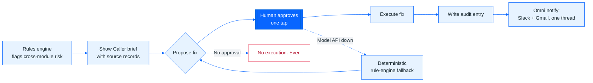
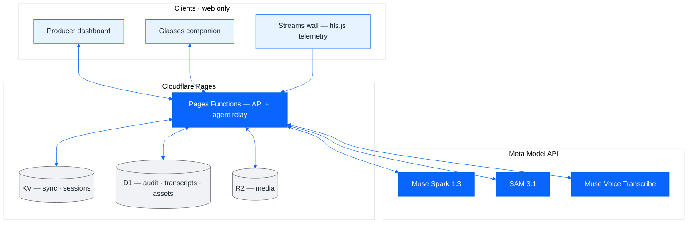

<p align="center">
  
</p>

<h1 align="center">Muse Live</h1>

<p align="center">
  <b>An operations safety net for live broadcast.</b><br>
  Plan every show, watch every stream end to end, learn from every incident.<br>
  Muse reads the whole production, proposes fixes with the records behind them, and a human approves. No approval, no execution.
</p>

<p align="center">
  <a href="https://muse-live.pages.dev"></a>
  <a href="https://muse-live.pages.dev/about"></a>
</p>

<p align="center">
  
  
  
  
  
</p>

---

## The problem

Live broadcast runs on scar-tissue judgment. The failure modes are cross-module: an encoder dies *while* a camera operator is double-booked *while* the backup path is promised to another show — and no single human watches schedule, streams, crew, equipment, and comms at once. Muse Live is the one place that does, with an agent that proposes the fix and a human who decides.

**Carlos Hurtado** designed and built Muse Live: product, front end, edge functions, the Muse agent, tests, and deployment. [GitHub](https://github.com/carloshurtado-tech)

## What Muse does (the loop)

1. **Detect** — Show Caller builds a deterministic, rules-based risk brief across schedule, streams, incidents, crew, and equipment. Every line carries the source record it came from; nothing is invented.
2. **Propose** — each risk comes with a concrete fix. The Muse drawer (Muse Spark) can also answer questions and draft changes against the same live snapshot.
3. **Approve** — a human approves with one tap. Approval re-verifies the world first; stale plans refuse themselves. Nothing moves an on-air booking.
4. **Execute** — the approved fix runs and an audit entry is written. The approval reachable in the UI today is the human-approved test-feed retry.
5. **Notify** — Omni files Slack and Gmail in the same per-show thread when production secrets are configured; without them, sends fail closed (`503 configured:false`), never simulated.

If the Meta Model API is unreachable, the deterministic rule engine keeps the safety net up — degraded, never silent.



## How Meta AI was used

| Model (Meta Model API) | Job in this project | Where |
|---|---|---|
| **Muse Spark 1.3** (`muse-spark-1.3`) | Muse drawer: reasoning + tool calls over the live production snapshot; every write returns as a Confirm card | `POST /api/museai` → [js/muse-agent.js](js/muse-agent.js) |
| **SAM 3.1** | Stream Check frame segmentation (lower-third `caption bar` concept); black frames caught by pixel math; errored checks report **unavailable**, never clean | [functions/api/streamcheck.js](functions/api/streamcheck.js), [js/muse-streamcheck.js](js/muse-streamcheck.js) |
| **Muse Voice Transcribe 1.0** (`muse-voice-transcribe-1.0`) | Chunked live captions (manual start only — playback never auto-starts billing) + searchable stored transcript with SRT/VTT export | [functions/api/transcribe.js](functions/api/transcribe.js), [js/muse-captions.js](js/muse-captions.js) |

Deliberately **not** used: no image-generation model is called anywhere (`grep -r muse-image js functions` → 0 hits; AI-generated survey photos are labelled illustrative in-app), no non-Meta LLM in the product path, and no silent model substitute — the fallback is deterministic rules.

## Architecture

Static app on Cloudflare Pages + Pages Functions, state in KV / D1 / R2, custom HMAC sessions (OIDC/PKCE + PBKDF2 where configured), prompt-injection fencing and per-session token budgets on the agent path. Web only: the control room, the truck, and the glasses companion reach the same backend.



## Proof (measured, Nov 1, 2026)

| Check | Result |
|---|---|
| `npm run check` (ESLint + `tsc` + unit, Node 22) | **292 / 292 pass** |
| Playwright e2e, Chromium (gate, crawl of every view + every show tab, streams, shade, sync, a11y) | **20 / 20 pass** |
| Playwright a11y + Sun & Shadow, Firefox | **3 / 3 pass** (axe WCAG 2.1 AA, light + dark: 0 violations) |
| Muse accuracy eval on the real model | **40 / 40**, median answer 5.8 s ([eval/REPORT.md](eval/REPORT.md)) |
| Stream Check offline fault matrix | Black 30/30, down 30/30, frozen 24/30, muted 27/30; 0 false alarms on 90 clean samples |

Every number above comes from a run log. Anything unmeasured is stated as a limit below, never estimated.

## What you'll see


<sub>**Streaming:** end-to-end health per show: encoder → SRT contribution → ingest → packaging → multi-CDN → player QoE, with a 99.9% availability SLO and error budget.</sub>

<table>
  <tr>
    <td width="50%"></td>
    <td width="50%"></td>
  </tr>
  <tr>
    <td><sub><b>Incidents:</b> blameless post-mortems with impact, time to detect and mitigate, root cause, timeline and owned follow-ups.</sub></td>
    <td><sub><b>Scheduling:</b> rooms, circuits, encoders, trucks and crew on one timeline, with conflicts and labor rules checked as you book.</sub></td>
  </tr>
</table>

Also in the app: per-show streaming plans and ABR ladders, hls.js QoE beacons, Muse Schedule with ICS calendar feeds, Finance (budget vs actuals), Omni (every conversation linked to its show), site surveys, and techbook PDF export from live data.

## On your face: the Meta Ray-Ban Display companion

The producer's view, on Meta glasses. The desktop publishes a live status every 10 seconds — every show's state and health, open incidents, and what's next on air (or "unknown", never invented) — and the [glasses app](glasses/) renders tally, alerts, and the show status a floor producer actually needs, built on `@wearables-ui-toolkit/mrbd` with the same sign-in as the main app. Publishing continues on a background cadence, so switching tabs never quietly turns the glasses into a demo; if the status goes stale for over 60 seconds, the glasses say "Demo data" out loud instead of presenting old numbers as live.

## Explore on your own

No sign-in needed for the guest path:

1. Open [muse-live.pages.dev](https://muse-live.pages.dev) and choose **Explore on your own** — you get a read-only guest session (every write endpoint refuses viewers).
2. Open the **Live Streams** wall and click any tile to enter the theater (transport, live measurements, captions repository).
3. Open a show and ask **Muse** a question; watch it read the plan of record and answer with its working shown.
4. Open [/glasses/](https://muse-live.pages.dev/glasses/) to see the same live status on the Meta Ray-Ban Display companion.

Team sign-in uses the access password (held by the owner; never published here).

## Repo map

| Path | What lives there |
|---|---|
| `js/muse-showcaller.js`, `js/muse-streamcheck.js`, `js/muse-streaming.js` | Risk brief, Stream Check, streams wall + theater |
| `js/muse-agent.js`, `functions/api/museai.js` | Muse drawer + model relay (keys stay server-side) |
| `functions/api/omni/`, `functions/api/transcribe.js`, `functions/api/voice.js` | Slack/Gmail connectors, captions, push-to-talk |
| `functions/_middleware.js`, `functions/_lib/` | Access gate, sessions, audit, abuse guards |
| `glasses/`, `glasses-src/` | Ray-Ban Display companion (built output + source) |
| `tests/unit/`, `tests/e2e/`, `eval/` | Unit + browser tests, model eval harness |
| `docs/` | [Architecture](docs/ARCHITECTURE.md) · [Security](docs/SECURITY.md) · [Runbook](docs/RUNBOOK.md) · [Migration](docs/MIGRATION.md) |

## Hackathon disclosure (before / during)

Built for the **Meta Global AI Developer Hackathon** (Oct 27 – Nov 4, 2026), Indie track, theme **Build for Your World** — the world here is live broadcast operations.

Muse Live itself predates the window: 32 commits are dated Oct 15–19, 2026, including the Oct 15 rebrand from an NBC "Pulse" operations tool (`fde343c`). Every commit whose message says "Day" is dated Oct 27, 2026 — "Day 1–7" names work packages, not separate calendar days. The Show Caller / Stream Check / captioning / Omni-connector layer and the full final-debug pass are in-window work. Nothing is backdated; the dated disclosure also lives on the [About page](https://muse-live.pages.dev/about#hackathon).

## Honest limits

- Viewer counts, bitrates, and pipeline metrics are simulated unless a show is connected to real telemetry; every simulated number is labelled *Demo*.
- Show Caller approval executes the test-feed retry today; Omni sends need production `SLACK_*` / `GMAIL_*` secrets and fail closed without them.
- Shared storage is last-write-wins per key unless clients send `If-Match` / `If-None-Match` (412 on conflict): fine for a small team, not strict multi-writer CAS.
- This is a concept demo, not an official Meta product.

## License

GPL-3.0 — see [LICENSE](LICENSE). The DWG importer is LibreDWG (GPL-3.0); third-party notices are in [THIRD_PARTY_NOTICES.md](THIRD_PARTY_NOTICES.md).

## Run it locally

```bash
npm ci                         # dev tooling only — the app itself has no runtime dependencies
cp .dev.vars.example .dev.vars # or create it: MODEL_API_KEY=…  MUSE_PASSWORD_HASH=…
npm run dev                    # http://127.0.0.1:8788
```

`MUSE_PASSWORD_HASH` is `sha256("muse-live:" + <password>)`:
`printf 'muse-live:%s' 'your-password' | shasum -a 256`.
Without `MODEL_API_KEY`, Muse answers from built-in rules (offline mode).

| Command | What it does |
|---|---|
| `npm run dev` | Local server with Functions + KV emulation |
| `npm run build` | Minify `js/muse-app-a.js` / `-b.js` → `*.min.js` + source maps, bump the `?v=` cache tag |
| `npm test` / `npm run check` | Unit tests / lint + typecheck + unit |
| `npm run test:e2e` | Playwright end-to-end tests against the dev server and a mock Meta Model API |
| `npm run stage` | Deployable copy (no tests, docs, sources, maps, or secrets) |

<p align="center"><sub>Muse Live is a concept demo by Carlos Hurtado and is not affiliated with or endorsed by Meta. Meta, Ray-Ban, Instagram, WhatsApp and Muse are trademarks of their owners. Event recordings belong to their owners.</sub></p>
